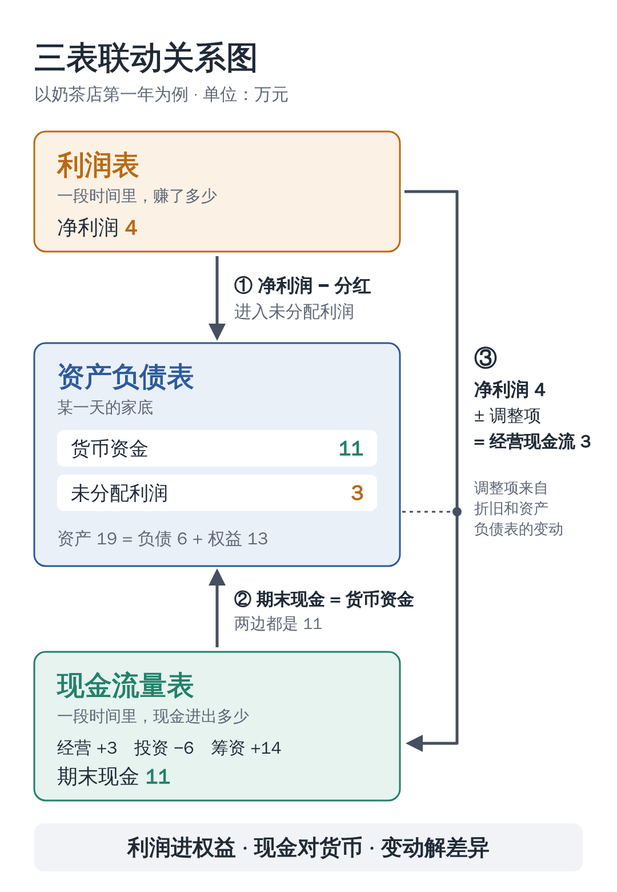

<!--
发布信息（不进正文）

备选标题：
  1. 一家奶茶店，讲透财报“三表联动”
  2. 三张表，一笔账：5 分钟看懂三表勾稽
  3. 赚了 4 万，为什么只多了 3 万现金？

摘要（≤120 字）：
  资产负债表、利润表、现金流量表不是三份孤立的文件。用一家奶茶店一年的账，讲清三条勾稽线：利润进权益，现金对货币，变动解差异。

封面图：images/cover.png（900×383）
正文配图：images/linkage.png（三表联动关系图）
-->

# 一家奶茶店，讲透财报“三表联动”

第一次翻财报，很多人会被三张表绕晕：资产负债表、利润表、现金流量表，每张都密密麻麻。

其实这三张表讲的是**同一盘生意**，只是角度不同。表与表之间的数字环环相扣，会计上把这种关系叫作**“勾稽关系”**。

今天用一家奶茶店一年的账，把三张表串起来讲。看完这篇，你也能自己动手核对一份财报。

---

## 一、三张表，各管什么？

先用一句话认识它们。

**资产负债表：某一天，公司有多少家底？**
它像一张**照片**，拍下的是某个时点（比如 12 月 31 日）的状况。
核心公式：**资产 = 负债 + 所有者权益**

**利润表：一段时间里，公司赚没赚钱？**
它像一张**成绩单**，记录一段时间（比如一整年）的经营成果。
核心公式：**收入 − 成本费用 = 利润**

**现金流量表：一段时间里，真金白银进出了多少？**
它像一本**银行流水**，只认实际收到、付出的钱。
核心公式：**期初现金 + 本期净流入 = 期末现金**

这里有两个区别，是理解三表联动的钥匙：

1. **时点和时期**：资产负债表看“某一天”，另外两张表看“一段时间”。
2. **应收和实收**：利润表里，货卖出去就记收入，钱没到账也算；现金流量表里，钱真正到手才算。

所以，**利润不等于现金**。记住这一点，后面就好懂了。

---

## 二、看一家奶茶店的一年

小林开了一家奶茶店。为了好算，我们**不考虑税费和利息**。第一年发生了 8 件事：

1. 自己拿出 **10 万元**开店（股东投入）
2. 向银行借款 **5 万元**
3. 花 **6 万元**买制冰机、封口机等设备
4. 进了 **4 万元**原料：现付 3 万，另外 1 万先欠着供应商
5. 全年卖奶茶 **12 万元**：收到现金 10 万；另有 2 万是附近公司的团购，约定下个月结账。这些奶茶用掉了 3 万元原料
6. 付房租、工资等 **4 万元**
7. 设备折旧 **1 万元**（设备用了一年，价值“用旧”了 1 万，但不用掏钱）
8. 年底给自己分红 **1 万元**

下面，三张表依次登场（单位：万元）。

### 利润表：一年赚了多少？

| 项目 | 金额 |
| --- | ---: |
| 营业收入 | 12 |
| 减：营业成本（用掉的原料） | 3 |
| 减：房租、工资 | 4 |
| 减：折旧 | 1 |
| **净利润** | **4** |

### 现金流量表：钱袋子怎么变？

现金流量表把现金进出分成三类：日常经营、买卖长期资产（投资）、找钱和还钱（筹资）。

| 项目 | 金额 |
| --- | ---: |
| 卖奶茶收到现金 | +10 |
| 买原料付出现金 | −3 |
| 付房租、工资 | −4 |
| **经营活动现金流** | **+3** |
| 买设备 | −6 |
| **投资活动现金流** | **−6** |
| 股东投入 | +10 |
| 银行借款 | +5 |
| 分红 | −1 |
| **筹资活动现金流** | **+14** |
| 现金净增加（3 − 6 + 14） | +11 |
| 期初现金 | 0 |
| **期末现金** | **11** |

### 资产负债表：年底的家底

| 项目 | 金额 |
| --- | ---: |
| 货币资金 | 11 |
| 应收账款（团购款还没收） | 2 |
| 存货（4 万原料用掉 3 万） | 1 |
| 固定资产（6 万设备减去折旧 1 万） | 5 |
| **资产合计** | **19** |
| 短期借款 | 5 |
| 应付账款（欠供应商的） | 1 |
| **负债合计** | **6** |
| 实收资本 | 10 |
| 未分配利润 | 3 |
| **所有者权益合计** | **13** |
| **负债和所有者权益合计** | **19** |

资产 19 = 负债 6 + 所有者权益 13，账平了。

---

## 三、三条勾稽线，把三张表串起来

### 第 ① 条：利润表 → 资产负债表

**净利润流进了“未分配利润”。**

公司赚的钱最终归股东，所以净利润会进入资产负债表的所有者权益。

> 期末未分配利润 = 期初未分配利润 + 本期净利润 − 分红

奶茶店：0 + 4 − 1 = **3 万**，和资产负债表上的 3 万对上了。

> 实际财报里还要减去“提取盈余公积”，原理一样：利润先进来，再按规定分出去一部分。

### 第 ② 条：现金流量表 → 资产负债表

**期末现金对上“货币资金”。**

现金流量表最后一行“期末现金及现金等价物余额”，应该和资产负债表的“货币资金”对得上。

奶茶店：现金流量表期末现金 11 万 = 资产负债表货币资金 **11 万**。

> 小提醒：上市公司的这两个数常常不完全相等。差额一般是**受限资金**，比如银行承兑汇票保证金、被冻结的存款。它们算在货币资金里，但不能随便动用，所以不算“现金及现金等价物”。差额的原因可以在财报附注里找到；如果差额很大又说不清，就要多留个心眼。

### 第 ③ 条：利润表 → 现金流量表

**从净利润，推出经营现金流。**

奶茶店赚了 4 万利润，经营活动却只流入 3 万现金。少的 1 万去哪了？

答案藏在资产负债表的变动里：

| 项目 | 金额 | 为什么 |
| --- | ---: | --- |
| 净利润 | 4 | 起点 |
| 加：折旧 | +1 | 记了费用，但没花钱 |
| 减：应收账款增加 | −2 | 记了收入，钱还没收回 |
| 减：存货增加 | −1 | 钱花了，货还在店里 |
| 加：应付账款增加 | +1 | 记了成本，钱还没付 |
| **经营活动现金流** | **3** | 和现金流量表一致 |

这种从净利润倒推经营现金流的方法叫**“间接法”**。上市公司年报里，现金流量表的**补充资料**就是这么一步步推出来的。

调整的规律只有三句：

- **不花钱的费用**（折旧、摊销、减值）：加回来
- **经营性资产增加**（应收、存货变多）：钱被占用了，减掉
- **经营性负债增加**（应付变多）：别人帮你垫了钱，加上

---

## 四、一张图记住三表联动

换个角度看：**资产负债表是主角**。年初拍一张照片，年末再拍一张，中间发生的事由另外两张表解释：

- **利润表**解释了“未分配利润”为什么变了
- **现金流量表**解释了“货币资金”为什么变了
- 其余科目的变动，解释了**利润和现金之间的差距**

浓缩成一句口诀：

> **利润进权益，现金对货币，变动解差异。**

---

## 五、学会勾稽，能用来做什么？

**1. 检查账做得对不对**

三条线只要有一条对不上，账一定有错。会计编完报表，第一件事就是核对勾稽关系。

**2. 看利润的“含金量”**

> 净现比 = 经营活动现金流 ÷ 净利润

这个比值长期大于 1，说明利润基本都变成了现金；长期远小于 1，甚至为负，就要问一句：钱去哪了？

奶茶店的净现比是 3 ÷ 4 = 0.75，主要是团购款还没收回来，问题不大。

**3. 发现风险信号**

- **利润年年涨，经营现金流却常年流出**：可能大量赊销、存货积压，严重的甚至是虚增收入
- **应收账款增速远远超过收入增速**：收入的质量要打个问号
- **账上躺着大笔现金，却同时借了大量高息贷款**（俗称“存贷双高”）：要警惕这些钱是否真实、能否动用

> 单个信号不等于有问题，一定要结合行业特点和财报附注一起看。

---

## 写在最后

三张表，讲的是同一个故事：

- **资产负债表**告诉你：家底有多厚
- **利润表**告诉你：本事有多大
- **现金流量表**告诉你：日子过得紧不紧

财务圈有句老话：**“利润是观点，现金是事实。”** 利润里有不少会计判断，现金却是实打实的进出。

下次翻财报，不妨先拿这三条线核一核。

*注：为便于理解，本文例子未考虑税费、利息和盈余公积等，实际财报会更复杂，但勾稽原理相同。*

**你觉得三张表里哪张最难懂？欢迎在评论区聊聊。**
