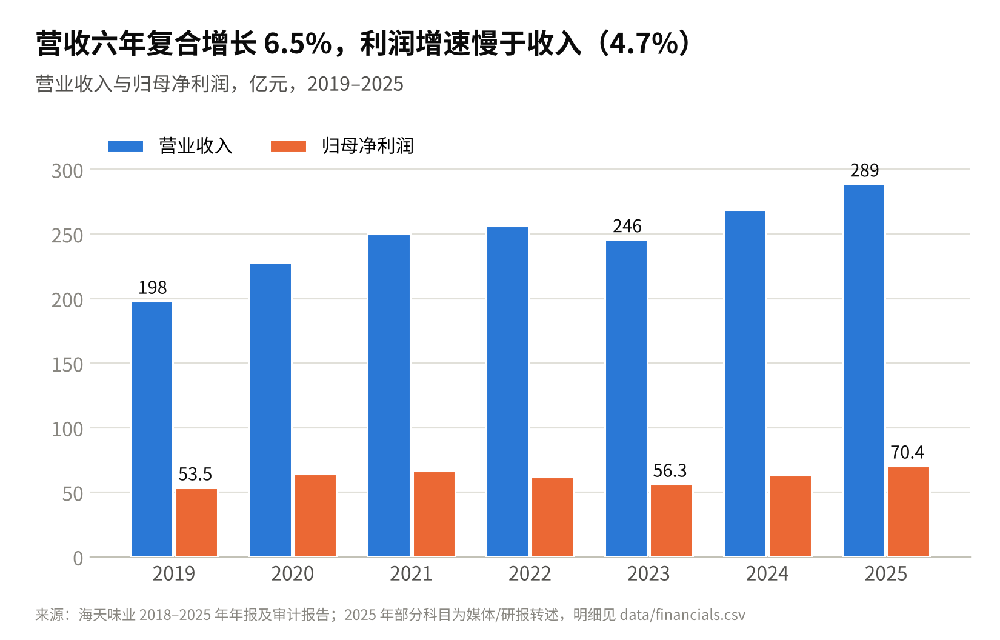
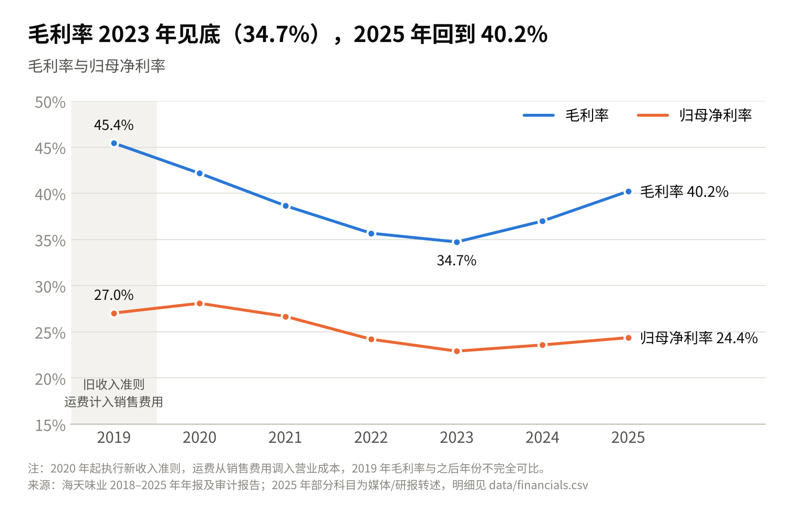
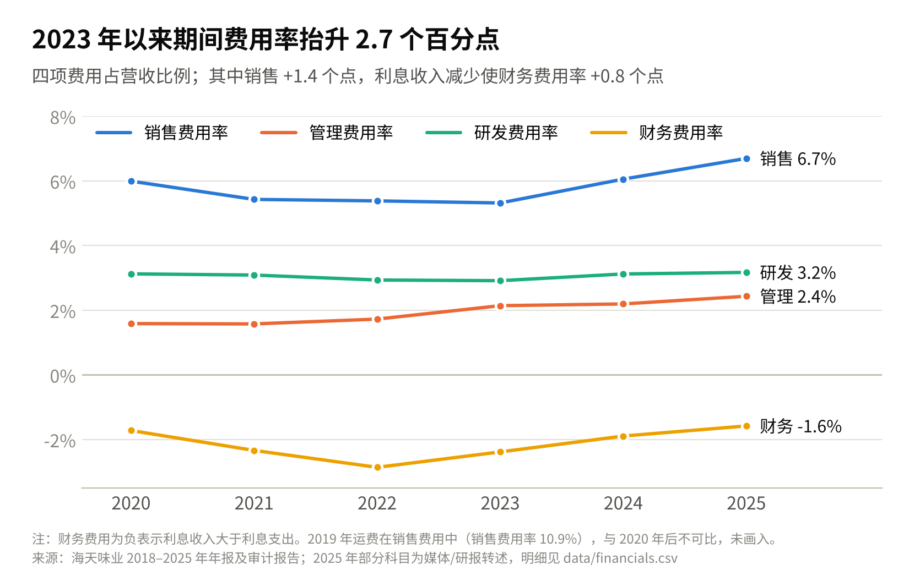
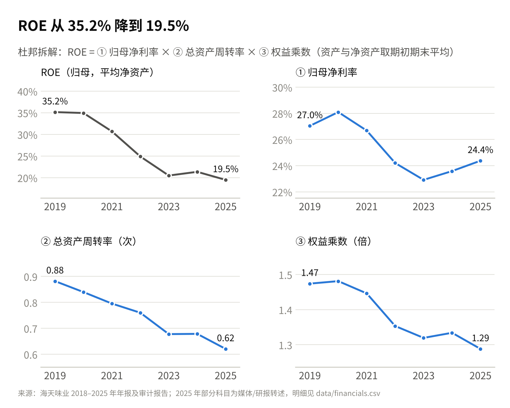
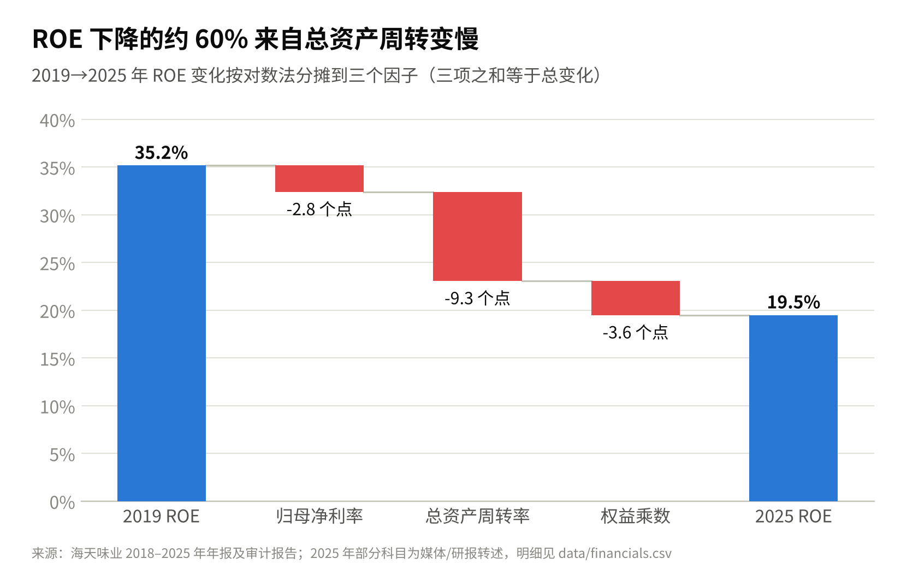
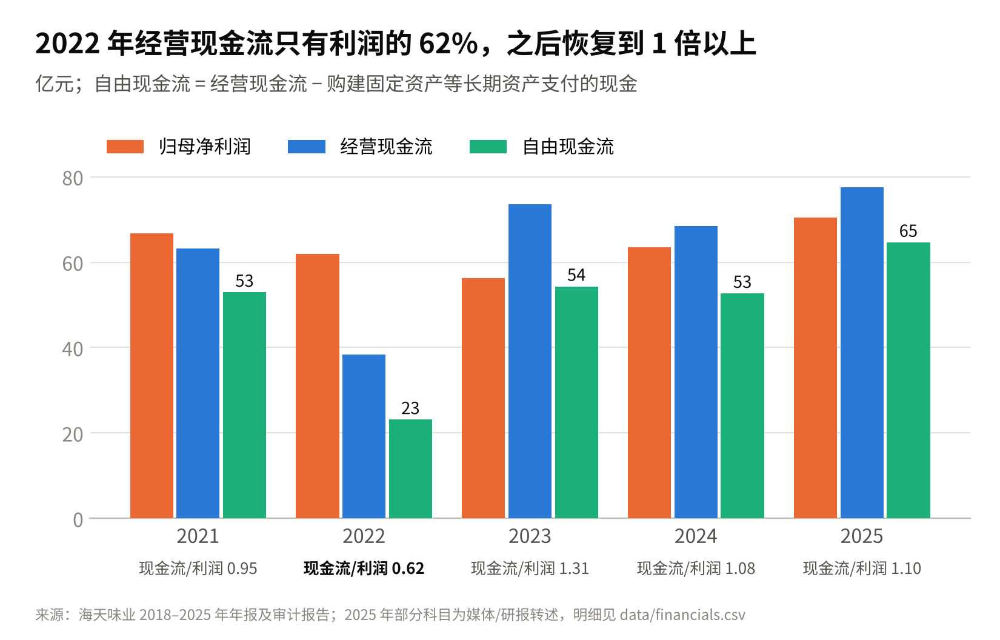
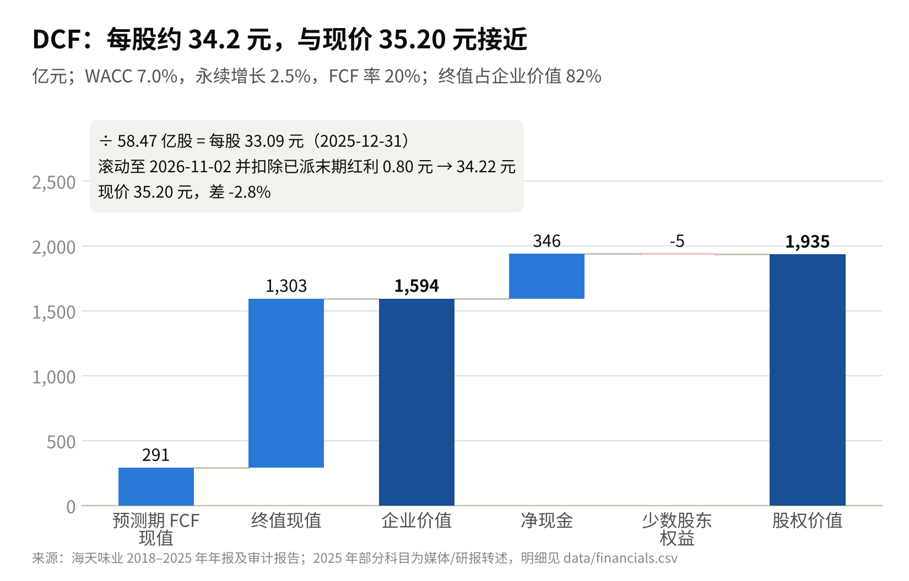
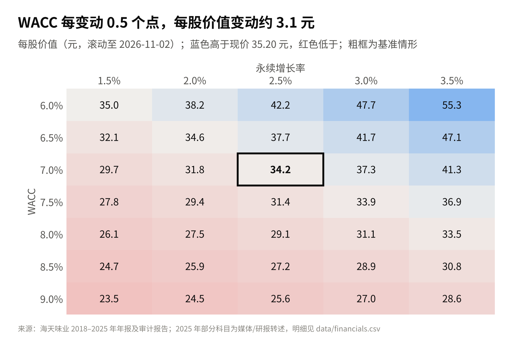

# 海天味业（603288）财务分析底稿

给公众号系列文章用的数据和分析：把 2019–2025 年年报里的财务数据整理成 CSV，再用脚本做杜邦拆解、毛利率与费用率趋势、简易 DCF，输出带公式的 Excel 和 8 张配图。

```
haitian/
├── data/
│   ├── financials.csv         年报财务数据（元），每行带来源链接、取数质量和备注
│   └── dcf_assumptions.csv    DCF 假设
├── analysis.py                计算：利润率、杜邦、现金流、DCF、敏感性、勾稽检查（入口）
├── charts.py                  配图
├── excel_export.py            生成带公式的 Excel
└── output/
    ├── haitian_analysis.xlsx  分析底稿（9 张表，512 个公式）
    └── charts/                01–08 号配图，PNG，1650 px 宽
```

## 怎么用

```bash
pip install -r requirements.txt
```

```bash
python analysis.py
```

- **改数据**：编辑 `data/financials.csv` 后重跑。金额单位是元，脚本统一换算成亿元。
- **改 DCF 假设**：编辑 `data/dcf_assumptions.csv` 后重跑；或者直接在 Excel 的“DCF”表里改黄底蓝字单元格，Excel 会自动重算（但图不会跟着变）。
- **字体**：脚本按 Noto Sans SC → 思源黑体 → 苹方 → 微软雅黑 → 文泉驿的顺序找中文字体，Mac 和 Windows 不用另装。

Excel 各表：说明｜数据｜数据来源｜利润率与费用率｜杜邦拆解｜现金流｜DCF｜敏感性｜勾稽检查。除了“数据”和“数据来源”，其余都是引用“数据”表的公式。颜色约定：蓝字是录入值，黑字是公式，绿字是跨表引用，黄底是关键假设。

## 数据口径与可信度

共 98 个数据点，每个都在 `financials.csv` 里标了取数质量：

| 质量 | 含义 | 个数 |
| --- | --- | --- |
| A | 年报或审计报告原文表格，精确到分 | 75 |
| B | 媒体或研报转述年报，亿元精度 | 17 |
| C | 由其他已披露数字推算 | 6 |

**发文前请对照年报原文核对 B、C 两类**，主要集中在 2025 年：营业成本、四项费用、归母净利润、扣非、经营现金流、资本开支、归母净资产和股本；另外还有 2019、2021–2023 年的归母净利润（亿元精度），2020 年的营业成本、研发费用，以及 2020–2022 年的资本开支。整理时年报 PDF 所在的网站（上交所、巨潮、东方财富）访问不了，这些数字只能先用转述值。

**勾稽检查**：用录入的绝对数算出的 56 个同比增速和毛利率，和年报披露值对比，55 个差异在 0.15 个百分点以内。唯一没通过的是 **2025 年管理费用**：媒体给的金额是 7.02 亿元（同比 +19.0%），证券之星给的增速是 +20.73%（对应约 7.12 亿元），两者对不上，需要以年报利润表为准。差额约 0.1 亿元，对费用率的影响不到 0.04 个百分点。

几处口径：

1. 2020 年起执行新收入准则，运费从销售费用调入营业成本。2019 年的毛利率和销售费用率与之后的年份不完全可比，图里已经标出。
2. 2024 年用原报数。2025 年报因同一控制下合并海天创新，重述了 2024 年数，营收只差 0.035 亿元。
3. 杜邦拆解用归母净利润和归母净资产，资产和净资产取期初期末平均。算出的 2025 年 ROE 是 19.5%，年报披露的加权平均 ROE 是 19.29%，差别来自加权方式（H 股 6 月才发行）。

## 主要发现

### 1. 增长：收入稳，利润慢



营收从 2019 年的 198.0 亿元增长到 2025 年的 288.7 亿元，年复合增速 6.5%。归母净利润从 53.5 亿元增长到 70.4 亿元，年复合增速 4.7%。2023 年营收下滑 4.1%；利润在 2022、2023 年连续下降（−7.1%、−9.2%），2024 年起恢复。

### 2. 毛利率：2023 年见底后回升



毛利率从 2019 年的 45.4%（旧准则口径）一路降到 2023 年的 34.7%，2025 年回到 40.2%，是 2020 年以来首次重回 40% 以上。据年报，2025 年营业成本只增长 1.8%，主要是原材料采购成本下降，制造费用也同比减少。

### 3. 费用率：毛利率回升的成果被费用吃掉一半



2023→2025 年，毛利率提升了 5.5 个百分点，但期间费用率也上升了 2.7 个百分点，归母净利率只提升了 1.5 个百分点。费用率上升的拆分：

| 项目 | 2023 | 2025 | 变化 |
| --- | --- | --- | --- |
| 销售费用率 | 5.32% | 6.69% | +1.38 个点（年报解释：人工、股份支付、广告） |
| 管理费用率 | 2.14% | 2.43% | +0.29 个点（人工、股份支付） |
| 研发费用率 | 2.91% | 3.17% | +0.26 个点 |
| 财务费用率 | −2.38% | −1.58% | +0.80 个点（利率下行，利息收入减少） |
| 期间费用率 | 7.99% | 10.72% | +2.73 个点 |

### 4. 杜邦拆解：ROE 下降主要是资产周转变慢





ROE 从 2019 年的 35.2% 降到 2025 年的 19.5%，下降 15.7 个百分点。按对数法把这次下降分摊到三个因子：

- **总资产周转率**：0.88 → 0.62 次，贡献 −9.3 个点，约占降幅的六成；
- **权益乘数**：1.47 → 1.29 倍，贡献 −3.6 个点。负债占比本来就低，还在继续降；
- **归母净利率**：27.0% → 24.4%，贡献 −2.8 个点。

也就是说，ROE 下降主要不是“每卖一块钱赚得少了”，而是资产越积越多、周转越来越慢。2025 年末，货币资金加交易性金融资产合计 347 亿元，占总资产的 66.5%；同年 H 股募资约 100 亿港元，使归母净资产一年增长 33.8%。不过“周转变慢主要因为现金堆积”这个判断要严格成立，还需要补 2019–2024 年的货币资金和理财数据，把总资产拆成经营资产和现金类资产。这是下一步可以补的数据。

### 5. 现金流：2022 年是例外



2019–2025 年，经营现金流/利润除 2021 年（0.95 倍）和 2022 年外都在 1 倍以上。2022 年只有 0.62 倍（经营现金流 38.3 亿元），2023 年回升到 1.31 倍。资本开支在 2023 年达到高点 19.2 亿元（占营收 7.8%），2025 年回落到 12.8 亿元（4.4%），自由现金流达到 64.6 亿元。

### 6. 简易 DCF：股价基本反映了当前预期





两阶段 DCF，估值基准日 2025-12-31：

| 假设 | 取值 | 依据 |
| --- | --- | --- |
| 收入增速 2026–2030E | 8%、8%、7%、6%、5% | 2026E 参考券商一致预期（营收约 312–316 亿元），之后逐年放缓 |
| FCF 率（占营收） | 20% | 2023–2025 年调整后 FCF 率均值 19.9% |
| WACC | 7.0% | 无风险利率 1.8% + Beta 0.8 × 股权风险溢价 6.5%；有息负债可忽略 |
| 永续增长率 | 2.5% | |

处理上有三处细节：

- **剔除利息收入**：海天的存款利息收入在经营现金流里，估值时又会单独加回净现金。为避免重复计算，先从历史 FCF 里扣掉税后利息收入，再算 FCF 率。
- **净现金保守计**：只算货币资金加交易性金融资产，减去短期借款，合计 345.7 亿元。2025 年三季度末“其他非流动资产”里还有约 66 亿元，可能是大额存单，没有计入；如果计入，估值日每股价值约加 1.1 元。
- **与现价对齐**：每股价值先按 WACC 滚动到股价日（2026-11-02），再扣除期间已派的 2025 年末期红利 0.80 元/股，才和现价比较。

结果：

- 企业价值 1,594 亿元，其中终值占 82%；加净现金、减少数股东权益后，股权价值 1,935 亿元。
- 每股价值 33.09 元（估值日）。滚动并扣除红利后为 **34.22 元**，比现价 35.20 元低 2.8%。
- 反过来看，现价隐含的永续增长率是 2.67%，隐含的 FCF 率是 20.7%，都和基准假设很接近。
- 估值对折现率很敏感：WACC 每变动 0.5 个百分点，每股价值变动约 3 元。在 WACC 6.5%–7.5%、永续增长 2%–3% 的范围内，每股价值在 29.4–41.7 元之间。

按这组假设，现价基本反映了“收入中高个位数增长 + 20% FCF 率”的预期，没有明显的安全边际，也没有明显高估。结论高度依赖 WACC 和永续增长率，文章里建议把敏感性表和隐含增长率一起放出来。

## 局限和下一步

- **数据核对**：B、C 类数据需要对照年报原文。环境放开对 `static.cninfo.com.cn` 或 `static.sse.com.cn` 的访问后，可以直接下载年报 PDF 逐项核对。
- **假设**：无风险利率 1.8% 和 Beta 0.8 都是假设值，发文前请按估值日的中债 10 年期收益率和实际 Beta 更新。
- **模型**：FCF 率按营收的固定比例，没有单独预测营运资本和资本开支；估值基准日是 2025 年末，没有纳入 2026 年前三季度的数据。
- **杜邦扩展**：补齐历年现金和理财数据后，可以把总资产周转率拆成“经营资产周转率”和“现金类资产占比”，验证第 4 节的判断。
