# 估值模型全攻略：PE、PB、EV/EBITDA、DCF 怎么选、怎么用、怎么避坑

> 估值是投资、投行、PE/VC 和财务分析的基本功，也是最容易“学会了公式、用错了地方”的一门手艺。本文用一个贯穿全文的案例，把主流估值模型的原理、适用场景、实操步骤和常见陷阱一次讲清楚。全文较长，建议收藏后慢慢看。

## 写在前面：估值到底在估什么？

先看一个问题：A、B 两家公司，今年都赚了 1 亿元。A 的市值是 10 亿元，B 的市值是 50 亿元。市场疯了吗？

不一定。如果 A 是一家钢厂，今年赚钱是因为钢价暴涨，明年可能就亏损；B 是一家品牌消费品公司，利润每年稳定增长 20%，几乎不需要额外投入。那 B 值更多钱，再正常不过。

这就是估值要回答的问题：**一家公司到底值多少钱，凭什么值这么多。**

开始之前，先建立三个基本认识：

1. **价格不等于价值。** 价格是市场此刻的报价，价值是对企业未来创造现金能力的判断。估值的意义，就在于发现两者之间的偏离。
2. **估值的本质，是给未来定价。** 无论用哪个模型，最终都绕不开三个问题：未来能赚多少钱，能持续多久，风险有多大。
3. **估值结果是一个区间，不是一个精确数字。** 投资圈常说“宁要模糊的正确，也不要精确的错误”。精确到小数点后两位的目标价，并不比一个有理有据的区间更可靠。

## 一、一张图看懂估值方法全景

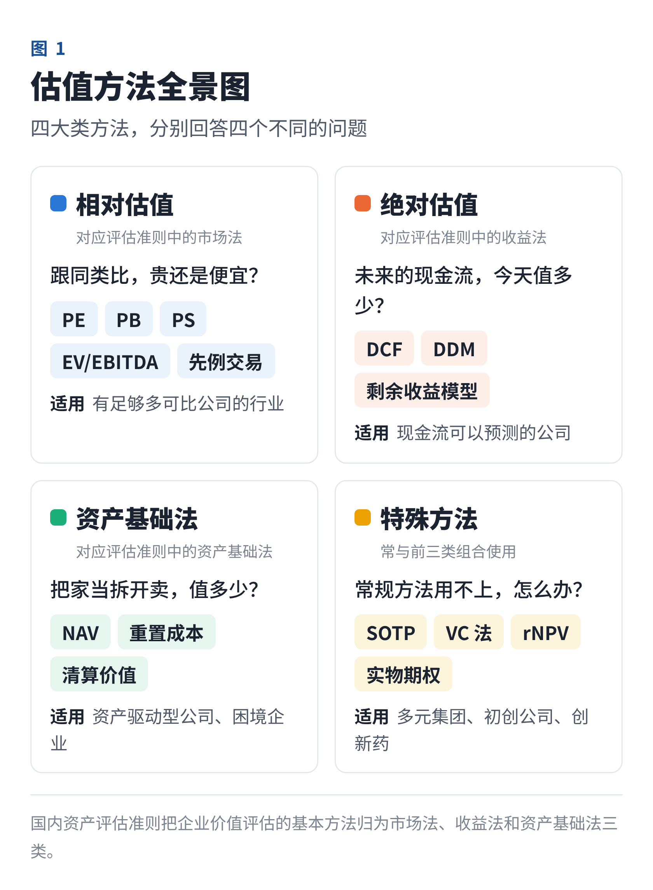

估值方法五花八门，但可以归为四大类：

| 类别 | 核心逻辑 | 代表方法 |
|---|---|---|
| 相对估值 | 和同类资产比价 | PE、PB、PS、EV/EBITDA、先例交易 |
| 绝对估值 | 未来现金流折现 | DCF、DDM、剩余收益模型 |
| 资产基础法 | 资产逐项重估 | NAV、重置成本、清算价值 |
| 特殊方法 | 针对特殊对象 | SOTP、VC 法、rNPV |

在国内资产评估实务中，前三类分别对应评估准则里的三大基本方法：**市场法、收益法、资产基础法**。下面逐一拆解。

## 二、相对估值：最常用的“比价法”

### 1. 原理：同类资产，应该卖同类价格

想知道自己的房子值多少钱，最快的办法不是算它能出租多少年，而是看看同小区、同户型最近成交的单价，再乘以自己的面积。

相对估值就是这个思路：

```formula
目标公司价值 = 可比公司的估值倍数 × 目标公司的对应指标
```

关键只有两件事：**选什么倍数，跟谁比。**

### 2. 五个最常用的倍数

**① 市盈率 PE = 市值 ÷ 净利润（= 股价 ÷ 每股收益）**

- **通俗理解**：按现在的赚钱能力，多少年能回本。PE 20 倍，相当于 20 年回本；倒过来就是 5% 的“盈利收益率”，可以直接和国债、理财的收益率做比较。
- **适用**：盈利稳定、可预测的成熟公司，比如消费、医药、家电和部分制造业。
- **不适用**：亏损公司（PE 为负，没有意义）、强周期公司（后面专门讲）、一次性收益占比很大的公司。
- **三种口径不要混用**：静态 PE（LYR）用上一个完整财年的利润；滚动 PE（TTM）用最近四个季度的利润；动态 PE（Forward）用预测的未来利润，研报和投资决策中最常用。

进阶指标是 **PEG = PE ÷（未来净利润年复合增速 × 100）**。它由投资大师彼得·林奇推广，PEG 约等于 1 通常被视为合理。比如 A 公司 PE 30 倍、利润增速 30%，PEG 为 1；B 公司 PE 20 倍、增速 10%，PEG 为 2。表面上更贵的 A，按成长性算反而更便宜。注意 PEG 只适合增速稳定在 10%～40% 左右、增长可持续的公司。

**② 市净率 PB = 市值 ÷ 净资产**

- **通俗理解**：花多少钱买 1 元的账面净资产。
- **适用**：资产以金融资产为主、账面价值接近真实价值的行业，比如银行、保险、券商；也常用来判断重资产周期股的底部。
- **不适用**：轻资产公司，比如软件、互联网和咨询。它们最值钱的品牌、技术和人才，基本不在资产负债表上。

**PB 一定要和 ROE 一起看。** 因为 PB = PE × ROE，ROE 20% 的公司和 ROE 5% 的公司，PB 不在一个量级是正常的。理论上：

```formula
合理 PB =（ROE − g）÷（股权成本 − g）
```

比如某银行 ROE 11%、股权成本 10%、长期增速 3%，合理 PB ≈（11% − 3%）÷（10% − 3%）≈ 1.14 倍；如果 ROE 降到 8%，合理 PB 只有约 0.71 倍。这也解释了很多银行为什么长期“破净”：市场判断它们未来的 ROE 赚不回股东要求的回报。

**③ 市销率 PS = 市值 ÷ 营业收入**

- **适用**：还没盈利、但收入快速增长的公司，比如 SaaS 软件、早期互联网、刚开始商业化的创新药企业。
- **缺点**：收入不等于利润。毛利率 80% 的软件公司和毛利率 10% 的贸易公司，PS 完全没法放在一起比。由于 PS = PE × 净利率，用 PS 时一定要同时看毛利率，以及长期利润率能做到多少。

**④ EV/EBITDA = 企业价值 ÷ 息税折旧摊销前利润**

这是投行和并购领域最常用的倍数。要用好它，得先搞清楚什么是 EV。

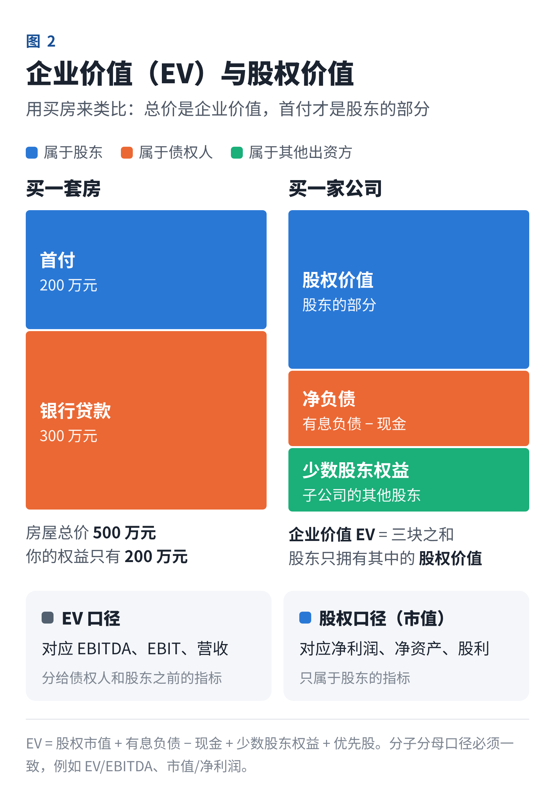

还是用买房来类比：一套房总价 500 万元，你付了 200 万元首付，向银行贷款 300 万元。房子的总价值是 500 万元，相当于**企业价值（EV）**；真正属于你的是 200 万元，相当于**股权价值**。

```formula
EV = 股权市值 + 有息负债 − 现金 + 少数股东权益 + 优先股
```

为什么要用 EV/EBITDA？

- EBITDA 是还没分给债权人和政府、也没扣折旧摊销的经营利润，属于所有资本提供者，和 EV 的口径正好匹配；
- 它剔除了负债多少、税率高低、折旧政策的差异，适合比较资本结构不同、不同国家的公司，也适合并购定价；
- **适用**：重资产、高负债、折旧大的行业，比如电信、电力、化工、物流、数据中心。

它的缺点是不扣资本开支。对需要持续大量投入才能维持经营的行业，EBITDA 会高估真正能拿到手的现金。巴菲特就曾在致股东信中调侃：难道管理层以为资本开支是牙仙子来付的吗？所以重资本开支的行业，最好同时看 EV/EBIT。

**⑤ 行业特色倍数**

很多行业有自己的“行话”：保险看 P/EV（市值 ÷ 内含价值）；REITs 看 P/FFO 和 P/NAV；矿业和油气看 EV/储量、EV/产能；资管公司看市值与管理规模（AUM）之比；互联网平台常参考 EV/GMV 和单用户价值。

> **划重点：分子和分母必须是同一口径。** EV 属于全体资本提供者，对应 EBITDA、EBIT、营收这类“分给所有人之前”的指标；股权价值（市值）只属于股东，对应净利润、净资产这类“股东口径”的指标。用 EV 除以净利润，或者用市值除以 EBITDA，都是口径错配。

### 3. 实操：可比公司法五步走

接下来用一个虚构案例贯穿全文：**小鲜饮品**，一家区域性饮料公司，2027 年预测营收 50 亿元、净利润 5 亿元、EBITDA 8.25 亿元。我们来给它估值。

**第一步：选可比公司。** 原则是业务相似优先，其次是规模、成长阶段和上市地点相近，通常选 5～10 家。注意两点：

- 不要只看行业分类，要看收入结构。同样是“饮料”，瓶装水、茶饮和乳饮的商业模式差别很大；
- 同一家公司在 A 股、港股、美股的估值可能差很多，跨市场比较要考虑流动性和投资者结构的差异。

**第二步：收集数据，统一口径。** 市值统一取同一个基准日；利润用扣除非经常性损益后的数据；财年不一致的公司要“日历化”，比如把 3 月结束的财年调整成自然年；预测数据优先用一致预期，Wind、iFinD、Bloomberg 等终端都能查到。

**第三步：计算倍数，取中位数。**

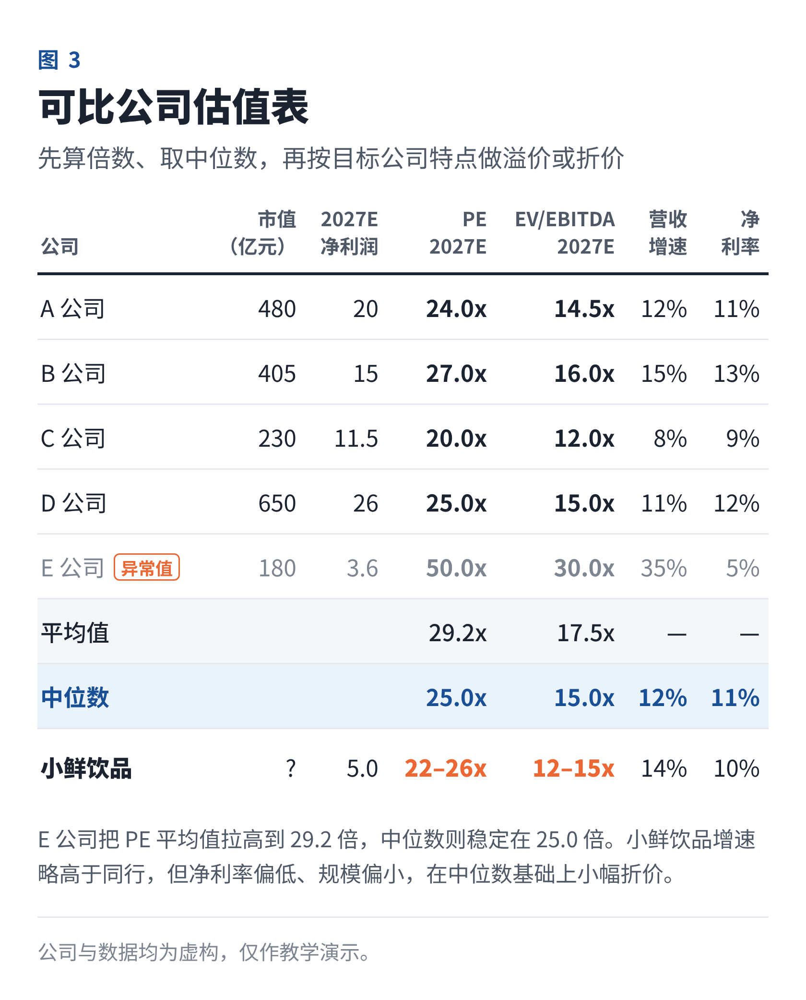

E 公司是一家高速扩张的新品牌，PE 高达 50 倍，明显是异常值。直接取平均数，会被它拉到 29.2 倍；取中位数则是 25 倍。所以实务中**优先用中位数**，并剔除负值和明显的异常值。

**第四步：结合目标公司的特点，给出溢价或折价。** 小鲜饮品的增速（约 14%）略高于同行中位数，但净利率（10%）偏低、规模偏小。综合考虑，给予小幅折价，取 **22～26 倍 PE**。常见的调整因素包括：成长性、盈利能力（ROE、利润率）、规模和行业地位、公司治理和信息透明度，以及是否涉及控制权；非上市公司通常还要打流动性折扣。

**第五步：算出估值区间。**

- **PE 法**：5 亿元 × 22～26 倍 = **110～130 亿元**；
- **EV/EBITDA 法**：可比公司中位数 15 倍，同样给予折价，取 12～15 倍，8.25 亿元 × 12～15 倍 = EV 99～124 亿元，再加上约 6 亿元的净调整项（构成见第三部分），股权价值约 **105～130 亿元**。

### 4. 相对估值的四个坑

**坑一：低 PE 不等于便宜。** 低 PE 可能意味着市场预期利润要下滑，最典型的就是周期股。

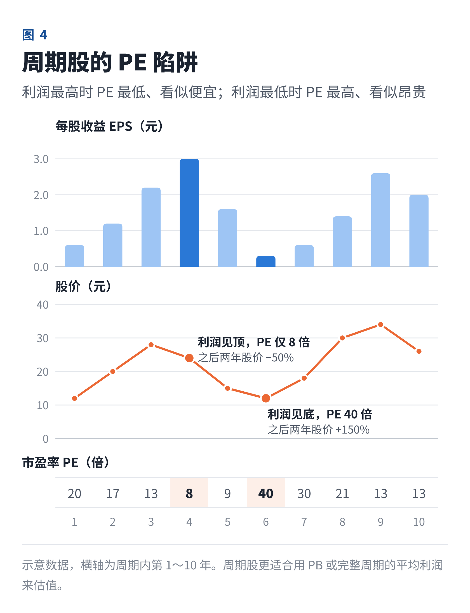

周期股在景气顶点时利润最高，PE 看起来最低，显得很便宜，但随后利润下滑、股价下跌；在行业低谷时利润微薄甚至亏损，PE 很高，显得很贵，却往往是布局的时点。所以市场有句老话：**周期股要在 PE 高时买，PE 低时卖。** 周期股更适合用 PB，或者用一个完整周期的平均利润（正常化利润）来计算 PE。

**坑二：可比公司并不可比。** 业务结构、成长阶段、商业模式、上市地点不同，倍数就失去了参考意义。

**坑三：口径不一致。** 有的用 TTM，有的用预测值；有的扣非，有的没扣。还有新租赁准则：租金被拆成了折旧和利息，EBITDA 因此变大，如果 EV 里没有同步加上租赁负债，倍数就会失真。

**坑四：整个板块都贵了，相对估值会失灵。** 相对估值只能告诉你“比同类贵还是便宜”，不能告诉你“整个行业是不是都太贵”。2000 年互联网泡沫时，用同行倍数给网络公司估值，只会越估越高。这时就需要绝对估值来“锚定”。

### 5. 补充：先例交易法

如果你在做并购，除了看上市公司的股价，还要看**历史上同类公司被收购时的成交倍数**，这就是先例交易法（也叫交易案例比较法）。

成交价通常包含**控制权溢价**（常见 20%～40%），有时还包含买方为协同效应多付的钱，所以结果一般高于可比公司法。使用时要注意交易时的市场环境、交易动机和支付方式是否可比。

在小鲜饮品的例子里，假设近年行业并购的 EV/EBITDA 在 15～18 倍，对应股权价值约 130～155 亿元。**这只适用于收购控股权的场景**，如果只是在二级市场买入少量股票，不能用这个数。

## 三、绝对估值之王：DCF 现金流折现模型

### 1. 原理：一棵果树值多少钱？

假设你要买一棵果树。它值多少钱，不取决于树有多高，也不取决于去年结了多少果，而取决于**未来每年能结多少果子、能结多少年、收成稳不稳定**。

再考虑一点：今天的 100 元比明年的 100 元更值钱，因为钱可以拿去投资，而且未来有风险。所以明年的果子要“打个折”才能换算成今天的价值，这个折扣率就是**折现率**。

```formula
企业价值 = 未来每年自由现金流的现值之和
第 t 年现金流的现值 = 该年现金流 ÷（1 + 折现率）^t
```

DCF 是所有估值方法的理论根基。相对估值里的各种倍数，本质上都是 DCF 的简化版：一家公司 PE 高，本质上是市场预期它未来现金流增长更快，或者风险更低。

### 2. 先分清两种自由现金流

| 项目 | 企业自由现金流 FCFF | 股权自由现金流 FCFE |
|---|---|---|
| 归属 | 股东 + 债权人 | 仅股东 |
| 计算 | EBIT ×（1 − 税率）+ 折旧摊销 − 资本开支 − 营运资本增加 | FCFF − 利息 ×（1 − 税率）+ 净借款 |
| 折现率 | 加权平均资本成本 WACC | 股权成本 Ke |
| 结果 | 企业价值 EV | 直接得到股权价值 |

实务中 **FCFF 用得最多**，因为它不受公司借款节奏的影响，更稳定。银行、保险等金融企业是例外：负债就是它们的“原材料”，经营和融资没法分开，一般用 DDM、剩余收益模型或 PB-ROE 框架。

FCFF 的公式拆开看很好理解：

- **EBIT ×（1 − 税率）**：主营业务赚到的税后利润，不考虑利息，也叫税后经营利润（NOPAT）；
- **加回折旧摊销**：会计上算作费用，但当期并没有真的花钱；
- **减去资本开支**：买设备、建工厂实打实花出去的钱；
- **减去营运资本增加**：生意做大了，应收账款和存货占用的钱也会变多，这部分钱被“锁住”了。

### 3. DCF 六步法

**第一步：预测未来 5～10 年的财务数据。**

这是 DCF 最花功夫的地方。收入通常这样拆解：

- 销量 × 单价；
- 市场规模 × 市场份额；
- 门店数 × 单店收入（零售、餐饮）；
- 用户数 × 每用户平均收入（互联网）。

然后是毛利率、费用率、资本开支和营运资本周转天数。每个假设都要有依据：历史数据、行业数据、管理层指引或者竞争对手对标。预测期的长度，原则是**一直预测到公司进入稳定增长状态为止**。成熟公司预测 5 年就够，高成长公司可以预测 10 年，或者分成两个阶段。

**第二步：算出每年的 FCFF。**

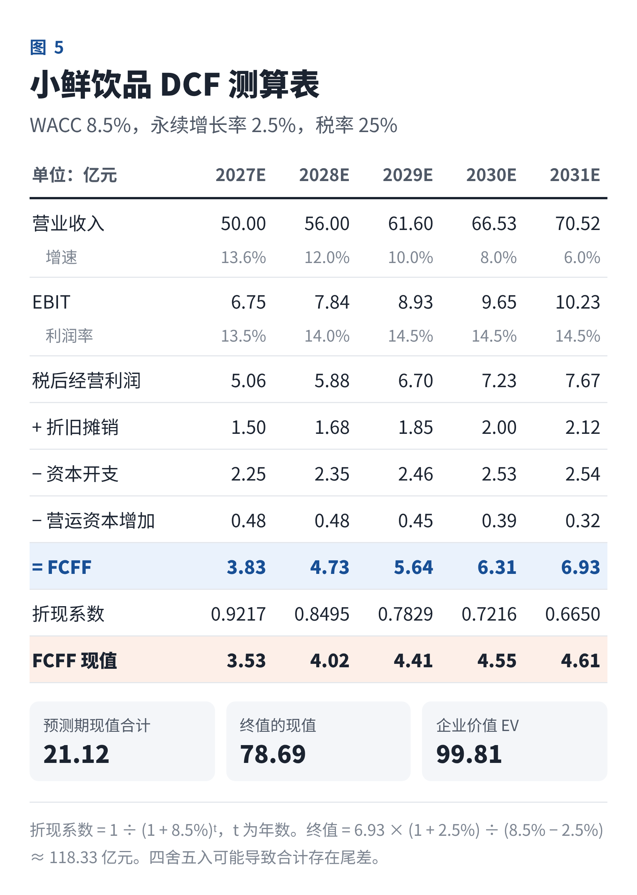

**第三步：估算折现率 WACC。**

```formula
WACC = 股权占比 × 股权成本 + 债务占比 × 债务成本 ×（1 − 税率）
股权成本 Ke = 无风险利率 Rf + β × 市场风险溢价 ERP
```

股权成本一般用资本资产定价模型（CAPM）来算，各参数的取法如下：

- **无风险利率**：通常用 10 年期国债到期收益率。中国近年已降到 2% 左右甚至更低，务必取估值基准日的实际数据。
- **β 系数**：衡量股票相对大盘的波动。非上市公司没有自己的 β，就找可比公司的 β，先“去杠杆”，再按目标公司的资本结构“加杠杆”：有杠杆 β = 无杠杆 β × [1 +（1 − 税率）× 债务 ÷ 股权]。
- **市场风险溢价**：投资股票相对无风险资产要求的额外回报，中国市场常见取值在 5%～7%。
- **额外风险溢价**：小公司、非上市公司，实务中常再加 1%～5% 的规模溢价或特定风险溢价，但要有理有据，不能拿来凑数。
- **债务成本**：公司实际借款利率，或同评级债券的收益率。
- **权重**：用目标资本结构（或行业平均）下的市场价值权重，而不是账面价值。

小鲜饮品：Rf = 2.0%，β = 1.1，ERP = 6.5%，所以 Ke = 2.0% + 1.1 × 6.5% = 9.15%；税前债务成本 4%，税后 3%；目标资本结构为股权 90%、债务 10%，WACC = 90% × 9.15% + 10% × 3% ≈ **8.5%**。

**第四步：计算终值（Terminal Value）。**

预测期结束后，公司还会继续经营下去，这部分价值用终值来概括。常用两种方法：

- **永续增长法（戈登模型）**：终值 = 预测期最后一年 FCFF ×（1 + g）÷（WACC − g）。g 是永续增长率，一般取 2%～3%，**不应超过长期名义 GDP 增速**，因为没有公司能永远比整个经济增长得更快。
- **退出倍数法**：终值 = 最后一年 EBITDA × 退出倍数，倍数参考可比公司。

两种方法最好互相验证。小鲜饮品的终值 = 6.93 ×（1 + 2.5%）÷（8.5% − 2.5%）≈ 118.3 亿元，折现到今天约 78.7 亿元。它隐含的退出倍数约为 2031 年 EBITDA 的 9.6 倍，低于当前可比公司 12～15 倍的水平。考虑到那时公司增速已经放缓到 6%，倍数下降是合理的，说明这个假设偏稳健。

**第五步：折现加总，从 EV 走到股权价值。**

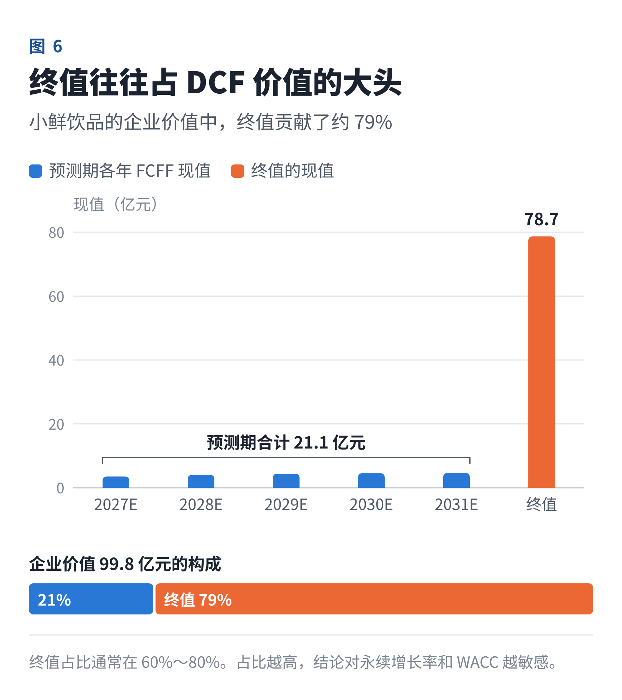

5 年预测期现金流的现值合计 21.1 亿元，终值现值 78.7 亿元，EV 约 99.8 亿元。**终值占了约 79%。** 这在 DCF 里很普遍（通常在 60%～80%），也说明了 g 和 WACC 这两个参数有多关键。

```formula
股权价值 = EV + 现金 − 有息负债 − 少数股东权益 + 非经营性资产
```

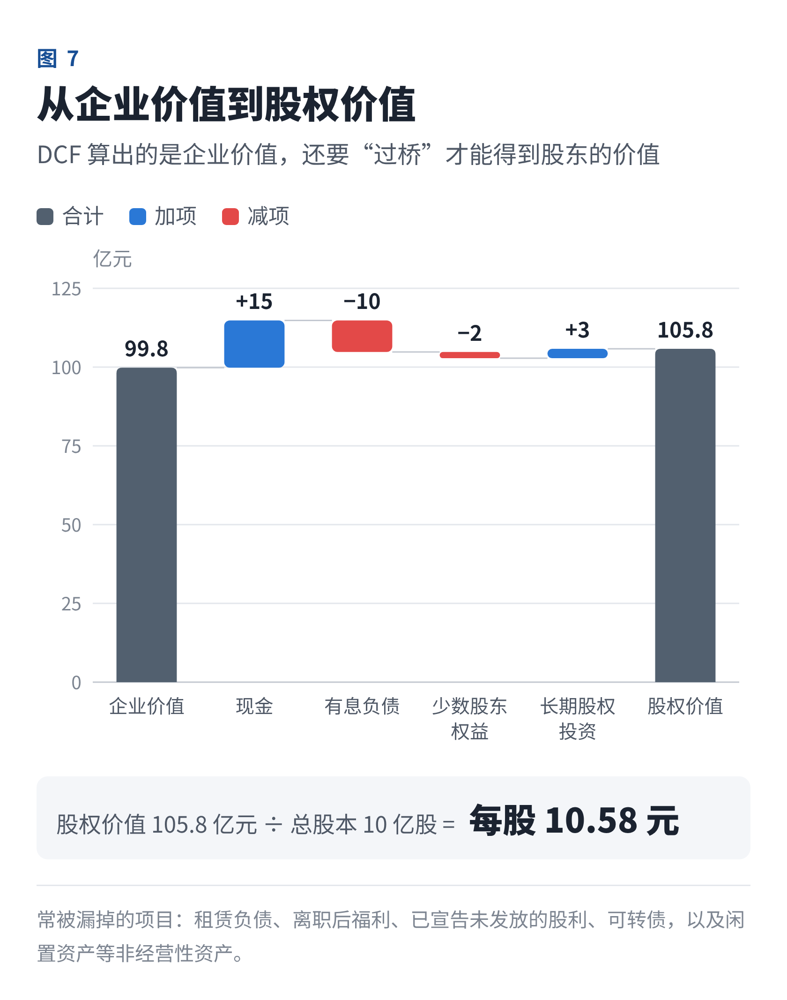

小鲜饮品：99.8 + 15 − 10 − 2 + 3 ≈ **105.8 亿元**，总股本 10 亿股，**每股约 10.6 元**。

这一步最容易漏项。常见的“类债务”项目还包括租赁负债、未足额计提的离职后福利、已宣告未发放的股利、可转债等；非经营性资产包括长期股权投资、闲置的土地和房产等。计算每股价值时，要用考虑了期权、限制性股票和可转债之后的**完全稀释股本**。

**第六步：敏感性分析。**

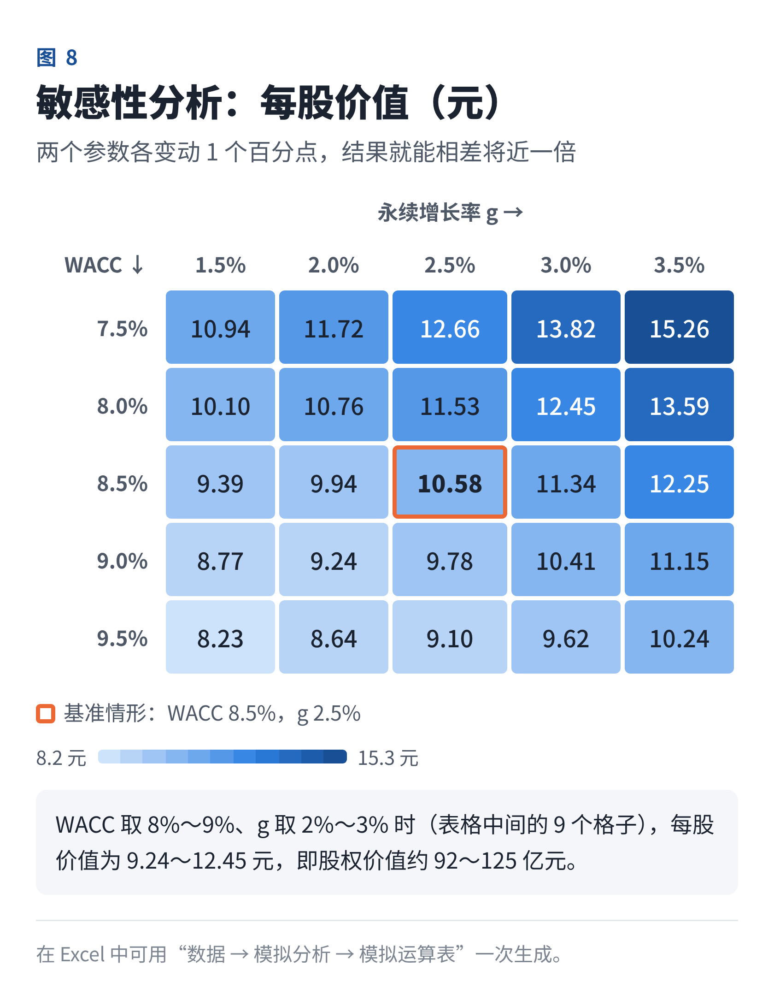

WACC 和 g 各自上下变动 1 个百分点，每股价值就在约 8.2～15.3 元之间变化。这张表告诉我们两件事：

1. **结论要用区间表达。** 取 WACC 8%～9%、g 2%～3% 的范围，小鲜饮品的股权价值约为 92～125 亿元。
2. **力气要花在最敏感的假设上**，把它们的依据弄扎实。

除了参数敏感性，还应做**情景分析**：设定乐观、中性、悲观三种经营情景（比如收入增速和利润率不同），分别算出价值，必要时按概率加权。

### 4. DCF 的六个常见错误

1. **垃圾进，垃圾出。** 模型再精巧，假设拍脑袋，结果也没有意义。
2. **曲棍球棒式预测。** 历史增速 5%，预测突然变成 30%，利润率还一路走高。每个拐点都要说得出理由。
3. **永续增长率过高。** g 越接近 WACC，终值越趋向无穷大；g 大于等于 WACC 时，公式直接失效。
4. **口径错配。** FCFF 配 WACC，FCFE 配 Ke；名义现金流配名义折现率；人民币现金流配人民币折现率。
5. **稳态假设自相矛盾。** 永续期要增长，就必须有再投资：稳态下，再投资率 = g ÷ 新增投资回报率（ROIC）。永续期资本开支低于折旧、营运资本不增加，却假设 3% 的永续增长，就是“既要马儿跑，又要马儿不吃草”。小鲜饮品终值年份的再投资率约 9.7%，隐含的 ROIC 约 26%，对一家品牌消费品公司来说尚属合理。
6. **倒推凑数。** 先定好想要的价格，再调参数去凑。这是 DCF 被诟病“主观”的主要原因。

### 5. 高手技巧：反向 DCF

与其问“这家公司值多少钱”，不如问：**现在的价格，隐含了市场什么样的预期？**

做法是把当前市值代入 DCF，固定其他参数，倒推出隐含的增长率或利润率，再判断这个预期是否现实。

比如，如果小鲜饮品当前市值是 150 亿元，在利润率等假设不变的情况下，需要 2028～2031 年营收每年增长约 24% 才能撑起这个价格，而我们的基准假设是年均约 9%。这个价格还算不算合理，就变成了一个很具体的商业问题：一家区域饮料公司，能不能连续四年保持 24% 的增长？反向 DCF 把“估值对不对”转化成了“这个预期靠不靠谱”，往往比正向 DCF 更有说服力。

## 四、其他绝对估值方法

### 1. DDM 股利折现模型

最古老的估值模型。股东最终能拿到的是分红，所以股票价值等于未来所有分红的现值。最简单的形式是戈登增长模型：

```formula
每股价值 = 下一年每股股利 ÷（股权成本 − 股利增长率）
```

例：某水电公司明年预计每股分红 0.6 元，股权成本 7%，长期分红增速 3%，价值 = 0.6 ÷（7% − 3%）= **15 元**。如果股权成本降到 6%，价值就变成 20 元。这也是利率下行时，高股息资产往往上涨的原因。

- **适用**：分红稳定、可预测的公司，比如公用事业、高速公路、银行和成熟的消费龙头。
- **不适用**：不分红，或分红政策不稳定的公司。

### 2. 剩余收益模型（RIM）

```formula
股权价值 = 当前净资产 + 未来每年超额收益的现值
超额收益 =（ROE − 股权成本）× 期初净资产
```

它背后的直觉是：只有当 ROE 超过股东要求的回报时，公司才在创造价值，才值得高于净资产的价格；ROE 低于股权成本，公司就在毁灭价值，应当折价交易。它和前面的 PB-ROE 框架一脉相承，特别适合银行、保险等以净资产为核心的金融企业，也常用来交叉验证 DCF。它的优点是价值的大头来自当前净资产，对终值的依赖较小。

### 3. 保险公司的内含价值法

寿险公司的利润要在很多年里慢慢释放，当期利润反映不了真实价值，所以行业通用**内含价值**：调整后净资产 + 有效业务价值。二级市场常用 P/EV 倍数。注意，这里的 EV 是 Embedded Value（内含价值），和前面的 Enterprise Value（企业价值）是两个概念。

## 五、资产基础法：把家当一件件算清楚

这类方法不看公司能赚多少钱，而是看它“有什么”：

```formula
股权价值 = 各项资产的公允价值 − 各项负债的公允价值
```

- **重估净资产法（NAV）**：每项资产按市场价重新评估。适用于房地产开发商（土地储备）、矿业资源公司（储量）、投资控股公司，以及持有大量物业的公司。
- **重置成本法**：重新建一个同样的企业要花多少钱。适用于重资产行业，也是周期股的“估值底”参考。
- **清算价值法**：如果现在关门变卖，能拿回多少钱。适用于困境企业和破产重整，是价值的最低线。

在国内，资产基础法广泛用于国有资产交易和并购重组中的评估报告。这类场景原则上要求采用两种以上方法评估，相互印证后再确定最终结论。

## 六、特殊情况怎么估？

**1. 多元化集团：SOTP 分部加总法。** 一家公司同时做家电、房地产和金融，用一个 PE 去估显然不合适。做法是：**每块业务分别用最合适的方法估值，加总后再扣除总部费用和净负债。** 比如家电业务用 PE、地产业务用 NAV、金融业务用 PB。注意，市场往往会给多元化集团打“集团折价”，常见 10%～30%，原因是外界对资本配置效率和信息透明度有疑虑。

**2. 初创公司：VC 法。** 没有利润甚至没有收入时，DCF 和 PE 都用不上，VC 常用倒推法：

- 先预测退出时的估值：比如 5 年后净利润 1 亿元，按 20 倍 PE，退出估值 20 亿元；
- 再按目标回报率折回今天：要求年化回报 40%，5 年约 5.38 倍，今天的投后估值约为 20 ÷ 5.38 ≈ 3.72 亿元；
- 投资 8000 万元，应占股约 21.5%；
- 考虑后续融资的稀释：如果预计之后还会被稀释 30%，本轮就需要约 30.7% 的股份，相当于投后估值只有约 2.6 亿元。

早期公司也常参考同类公司最近一轮的融资估值，或用户价值指标，比如用户生命周期价值与获客成本之比（LTV/CAC）。

**3. 创新药：rNPV（风险调整净现值）。** 每条在研管线单独做 DCF，再乘以它最终获批上市的概率。行业统计显示，从 I 期临床到最终获批，整体成功率通常不到一成，进入 III 期后大约一半（不同疾病领域差异很大）。这样就能把早期管线和即将上市的产品区分开来。

**4. 周期股。** 前面说过，避免用当期 PE。可以用 PB（结合历史 PB 区间）、一个完整周期的平均利润、EV/产能或重置成本。

**5. 亏损的成长型公司。** 可以用 PS、EV/Sales，也可以把 DCF 的预测期拉长到 10 年左右，一直预测到它盈利成熟之后，再折现回来。

## 七、怎么选？一张表对号入座

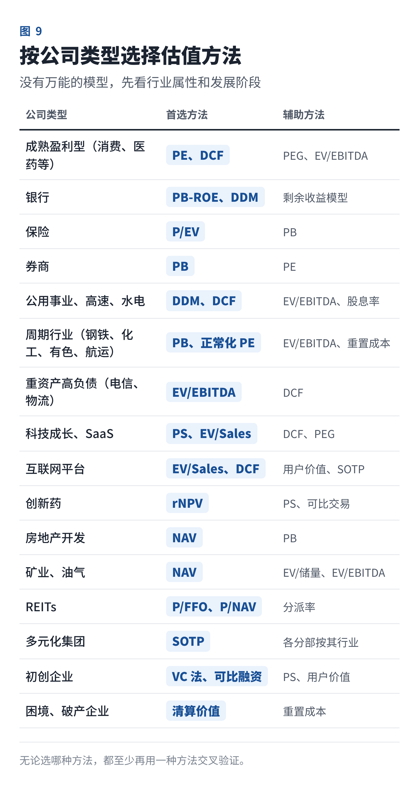

如果记不住这张表，可以按顺序问自己五个问题：

1. **是金融企业吗？** 是的话，用 PB-ROE、DDM、剩余收益模型，保险加上 P/EV。
2. **有稳定的盈利吗？** 有的话，用 PE 和 DCF；盈利随周期大起大落的，改用 PB 或正常化利润。
3. **没盈利，但有收入吗？** 用 PS、EV/Sales，或者拉长预测期的 DCF。
4. **连收入都没有？** 用 VC 法、可比融资估值，创新药用 rNPV。
5. **价值主要在资产，或者业务很多元？** 前者用 NAV、重置成本，后者用 SOTP。

无论选了哪种方法，**都至少再用一种方法交叉验证。**

## 八、实战：在工作中怎么完成一次估值

前面讲的是工具，这一部分讲流程。无论你在券商研究所、投行、PE/VC、企业战投还是财务部门，一次规范的估值大致都是下面七步。

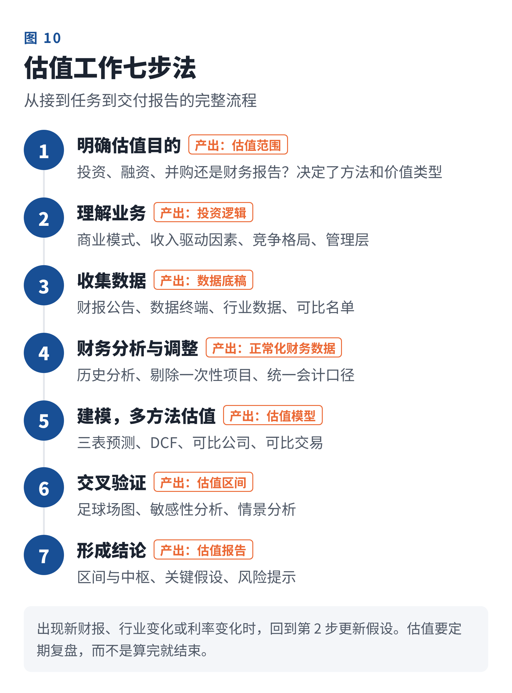

**第 1 步：明确估值目的。** 目的不同，方法和结论都会不同：

- **二级市场投资**：算目标价，买的是少数股权、流动性好，以可比公司法和 DCF 为主；
- **一级市场股权投资**：谈投前和投后估值，关注退出路径，常用可比公司、可比融资和 VC 法；
- **并购**：要考虑控制权溢价和协同效应，以及“对我这个买方值多少”，先例交易法很重要；
- **财务报告**：商誉减值测试、金融资产公允价值计量，要遵循会计准则。比如按照《企业会计准则第 8 号——资产减值》，计算未来现金流量现值时要用**税前**折现率，和投资估值的习惯不同；
- **其他**：IPO 定价、股权激励、国有资产转让、税务等，各有监管要求。

**第 2 步：理解业务。** 估值是用数字讲故事。打开 Excel 之前，先回答这些问题：公司靠什么赚钱？收入的驱动因素是什么？竞争优势能维持多久？行业天花板在哪里？管理层靠不靠谱？纽约大学的估值专家达摩达兰（Aswath Damodaran）有一个观点：好的估值是故事和数字的结合，没有数字支撑的故事只是空想，没有故事支撑的数字也是空洞的。

**第 3 步：收集数据。**

- **公司资料**：年报、招股说明书和公告（巨潮资讯网、港交所披露易、美国 SEC 的 EDGAR 系统），以及调研纪要；
- **市场数据**：Wind、iFinD、Choice、Bloomberg、Capital IQ 等终端；
- **行业数据**：统计局、行业协会、第三方咨询报告、券商研报；
- **可比名单**：可比公司和可比交易。

**第 4 步：财务分析与调整。** 分析过去 3～5 年的收入、利润率、ROE 和 ROIC、现金流和营运资本周转；剔除资产处置收益、政府补助、大额减值等一次性项目，得到“正常化”的利润；统一会计口径，比如租赁准则、研发费用资本化和收入确认方式。

**第 5 步：建模，多方法估值。** 搭建三张报表联动的预测模型，在此基础上做 DCF；同时做可比公司表和可比交易表；特殊情况再补充 SOTP、NAV 等方法。

**第 6 步：交叉验证与敏感性分析。** 把各方法的结果画在一张“足球场图”上，看它们是否大致重叠：

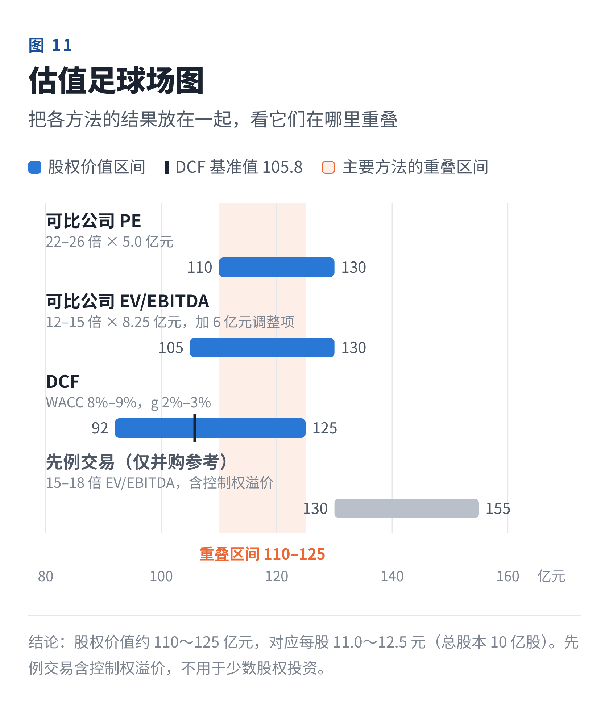

小鲜饮品的结果：PE 法 110～130 亿元，EV/EBITDA 法 105～130 亿元，DCF 92～125 亿元，三者的重叠区间约为 **110～125 亿元**。先例交易法的 130～155 亿元包含控制权溢价，只在收购控股权时参考。

各方法结果差异很大时，不要简单取平均，而要追问原因：可比公司选错了？DCF 假设太保守？还是市场整体估值偏高？**差异本身往往就是最有价值的信息。** 比如本例中 DCF 的中枢（约 106 亿元）低于可比公司法，提示要么我们的增长假设偏保守，要么行业整体估值已经不便宜。

**第 7 步：形成结论，写进报告。** 一份合格的估值结论应当包括：

- 估值区间和中枢，比如“股权价值 110～125 亿元，对应每股 11.0～12.5 元”；
- 采用了哪些方法，各自权重和理由；
- 关键假设及其依据；
- 敏感性分析的结果；
- 风险提示，以及“出现什么情况，这个估值就不成立”。

### Excel 建模实用技巧

- **输入、计算、输出分开放**：假设集中放在一个区域或单独的工作表里，计算部分全部引用假设单元格。
- **用颜色区分单元格**：蓝色字体是手工输入的假设，黑色是公式，绿色是引用其他工作表的数据。别人一眼就能看出哪些数可以改。
- **公式里不写死数字**：类似“=B5*1.1”的写法是模型出错的头号原因，应该写成“=B5*(1+增长率单元格)”。
- **留意 NPV 函数的默认设定**：Excel 的 NPV 函数默认第一笔现金流发生在第 1 期期末，不含第 0 期；现金流日期不规则时用 XNPV。如果采用“年中折现”（假设现金流在年内均匀发生），折现期数取 0.5、1.5、2.5……
- **用“模拟运算表”做敏感性分析**：在“数据 → 模拟分析 → 模拟运算表”中，一次生成 WACC × g 的二维表。
- **设置检查项**：资产负债表是否平衡、现金流量表的期末现金是否等于资产负债表的现金、终值占比、隐含退出倍数。
- **记录假设来源**：在关键假设旁边注明依据，比如“近三年平均值”“管理层指引”“行业协会预测”。这比模型本身更能经得起追问。

### 估值底稿自查清单

- ☐ 估值目的、基准日和价值类型是否明确？
- ☐ 方法是否与行业特点和公司阶段匹配？是否至少用了两种方法？
- ☐ 可比公司是否真的可比？日期、扣非、预测年份等口径是否统一？
- ☐ 收入和利润率预测是否有历史或行业依据？有没有“曲棍球棒”？
- ☐ 无风险利率、β、市场风险溢价是否有出处，是否与基准日匹配？
- ☐ 永续增长率是否低于长期名义经济增速？终值占比是否过高？
- ☐ 从 EV 到股权价值，是否漏掉了类债务项目或非经营性资产？是否用了稀释后股本？
- ☐ 是否做了敏感性分析和情景分析？
- ☐ 各方法之间的差异是否得到了合理解释？
- ☐ 结论是否用区间表达，是否写明了关键假设和风险？

## 九、正确使用估值模型的十条心法

1. **估值是区间，不是一个点。**
2. **没有最好的模型，只有最合适的模型。** 先看行业属性和公司阶段，再选方法。
3. **至少用两种方法交叉验证。** 相对估值告诉你市场怎么看，绝对估值告诉你它本身值多少。
4. **口径一致是底线。** EV 配 EBITDA，市值配净利润；FCFF 配 WACC，FCFE 配 Ke。
5. **假设比公式重要。** 模型谁都会搭，差距在于对业务的理解和假设的依据。
6. **警惕终值。** 终值占比过高，说明你算出的价值大部分来自很遥远的未来。
7. **知道哪个假设最致命。** 敏感性分析不是装饰，它告诉你研究精力应该花在哪里。
8. **多用反向思维。** 用反向 DCF 看看市场价格隐含了什么预期，再判断这个预期是否现实。
9. **估值不等于价格，更不等于买卖时机。** 价值决定价格的方向，但不决定节奏。买入要留出安全边际。
10. **持续更新。** 新财报、行业变化、利率变化都会影响估值，模型要定期复盘。

## 十、常见问题答疑

**问：PE 越低越好吗？**

答：不是。低 PE 可能是市场在提前反映利润下滑，比如周期顶点、行业衰退或公司竞争力下降。要结合增速（PEG）、盈利质量和周期位置一起看。

**问：DCF 的假设那么主观，还有用吗？**

答：有用。DCF 最大的价值不是最后那个数字，而是**逼着你把对公司的判断，包括增长、利润率、投入和风险，全部写成明确的数字**，让假设可以被检验、被讨论。

**问：为什么不同券商给同一只股票的目标价差别很大？**

答：因为假设不同。收入增速、利润率、折现率、目标倍数，任何一个差一点，结果都会差很多。看研报时，与其关注目标价，不如看清它的核心假设，再想想自己是否认同。

**问：亏损公司怎么估值？**

答：看它处在哪个阶段。有收入的，用 PS、EV/Sales 或拉长期限的 DCF；还没有收入的，看管线价值（rNPV）、用户价值或可比融资；如果是经营困难导致的亏损，可能要看资产价值，甚至清算价值。

**问：TTM PE 和预测 PE 用哪个？**

答：看用途。TTM 基于已经实现的数据，更客观，适合观察历史估值区间；预测 PE 反映未来，更适合投资决策和成长股，但依赖预测的准确性。最关键的是，可比公司之间要用同一种口径。

**问：非上市公司的估值和上市公司有什么不同？**

答：主要有两点。一是缺乏流动性，通常要打流动性折扣，实务中常见的幅度在 15%～35%，视退出前景而定；二是缺少市场数据，β 和可比倍数都要借助上市公司来推算。

## 写在最后

估值既是科学，也是艺术。科学的部分是公式和逻辑，几天就能学会；艺术的部分是对商业的理解和判断，需要长期积累。

模型是帮助思考的工具，不是替你做决定的答案。真正的高手，不是把模型搭得最复杂的人，而是最清楚“这个数字背后假设了什么、哪里可能出错”的人。

最后附上一张公式速查卡，建议保存。

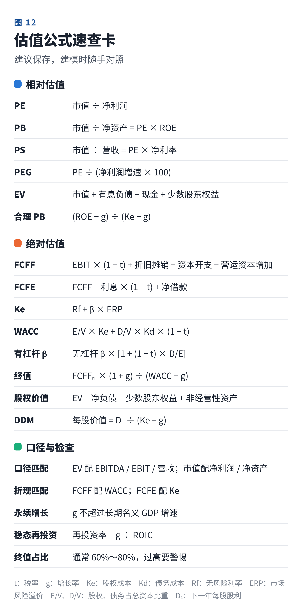

*注：文中“小鲜饮品”及 A～E 可比公司均为虚构，数据仅用于教学演示，不构成任何投资建议。*
